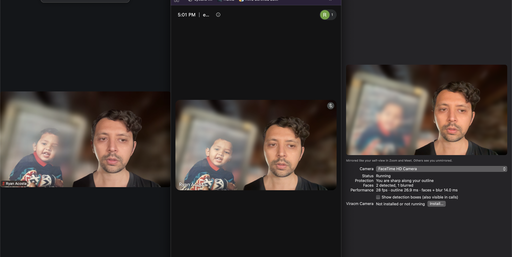
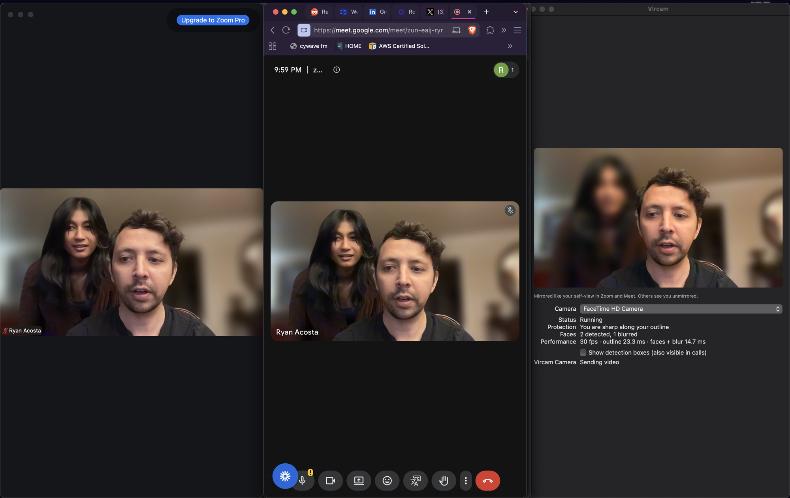
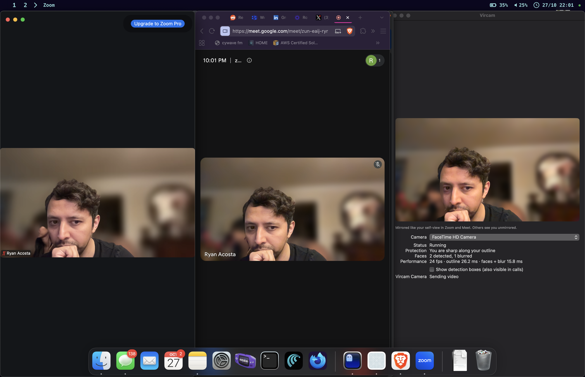
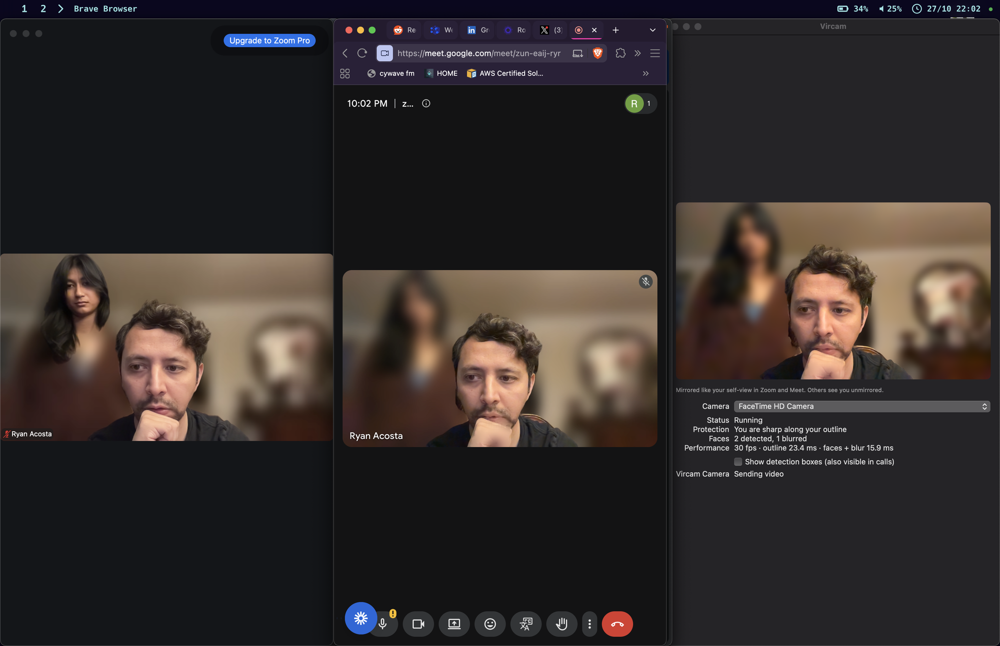
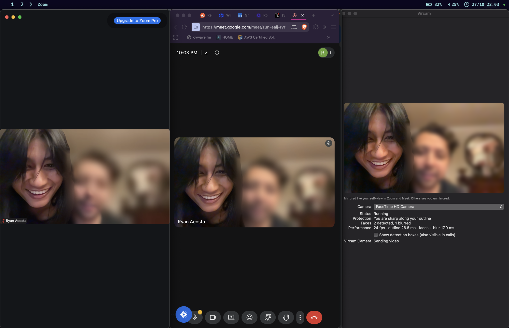
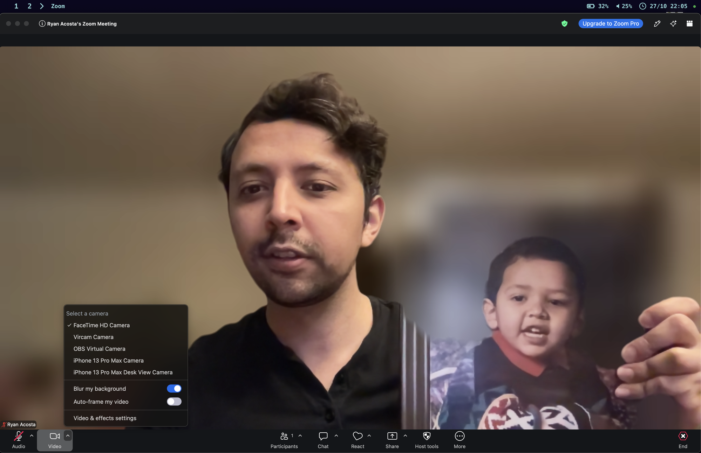
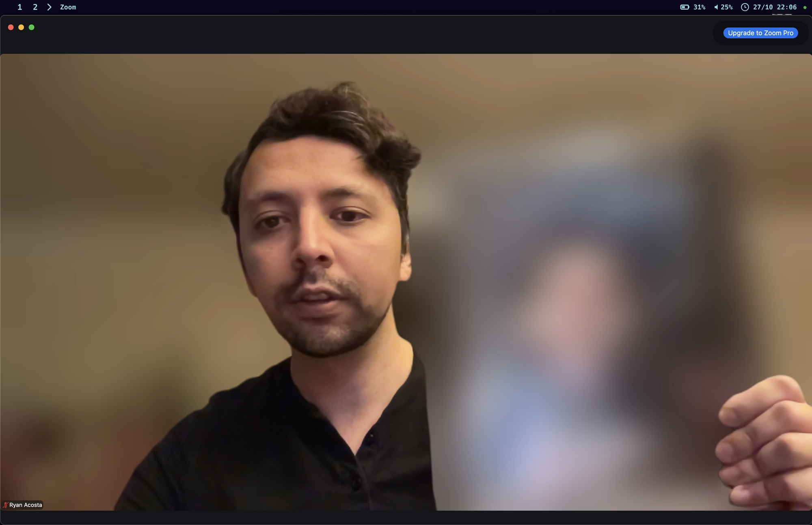

# Vircam

A virtual camera app for video call apps like Zoom and Google Meet that keep you sharp and everyone else blurry. 

I like to work remotely from coffee shops and I got sick of having floating heads appear on my calls. The worst is when they're just sitting their, minding their own business, yet Zoom and Google Meet make them a permanent fixture in your phone call.



*Left: Zoom's background blur. Middle: Google Meet's. Right: Vircam. Zoom and Meet keep
the child's face in the photo sharp because it looks like a person. Vircam blurs it.*



*Someone standing behind you. Left: Zoom. Middle: Google Meet. Both keep her face sharp.
Right: Vircam keeps only you sharp and blurs her.*



*A partly hidden face peeking in behind you. Zoom keeps it sharp. Vircam still detects
it and blurs it.*



*Google Meet (middle) using Vircam Camera: her face is blurred in the call. Zoom (left),
using its own blur, blurs her body but leaves her face sharp, a "floating head".*



*Zoom, Meet, and the Vircam preview all using Vircam Camera. Only one person is sharp
in every app. Here she leaned in close, so her face became the largest and Vircam
treated her as the user (see the limitation below).*

| Zoom's own blur | Zoom with Vircam Camera |
|---|---|
|  |  |

*A photo of a child held up to the camera. Left: Zoom's "Blur my background" keeps the
child's face completely sharp. Right: Zoom using Vircam Camera blurs it.*

## Why built-in blur leaks faces

Zoom and Meet split each frame into "person" and "background" and keep anything that
looks like a person sharp. A face behind you, or in a photo you hold up, is also a
person, so it stays sharp. Their masks are also recomputed every frame, so one
low-confidence frame can briefly show a face that was blurred a moment before. Zoom
can even blur someone's body while leaving their face sharp, a "floating head".

## How Vircam blurs all other faces

Vircam works the other way around: **the whole frame is blurred by default, and only
you are allowed to be sharp.**

1. **Find you.** Every face is detected and tracked frame to frame. The largest face,
   seen consistently, is treated as you. Someone else has to be clearly larger for half
   a second before they take over, so a person leaning in can't steal the spot.
2. **Keep only your outline sharp.** Each person's outline is detected separately
   (Apple Vision on macOS). Only the outline that contains your face is kept sharp.
   Everyone else, including people standing right next to you, stays blurred.
3. **Blur faces that overlap you.** If another face overlaps your outline, such as
   someone leaning over your shoulder, it is blurred even more heavily on top.
4. **Don't let faces flicker back.** A face the detector loses keeps its blur where it
   was last seen for 0.75 s.
5. **Fail closed.** If no single person can be confirmed as you, if you leave the frame
   for more than a second, or if anything errors, the entire frame is blurred. The raw
   camera feed is never sent.

Everything runs locally. No video leaves your computer.

**Limitation:** Vircam doesn't know who you are yet. It keeps the largest face sharp, so
someone who comes clearly closer to the camera than you for half a second takes over.
Recognizing the user by enrolled face is planned.

## Status

| Platform | State |
|----------|-------|
| macOS 14+ (Apple silicon) | Working; tested in Zoom and Google Meet. Without a paid Apple Developer account, macOS security must be relaxed to load the camera (see below). |
| Linux | Planned (v4l2loopback output, same C++ core). |

See [PLAN.md](PLAN.md) for the architecture and milestones.

## Build (macOS)

Requires Xcode 16, CMake, and [XcodeGen](https://github.com/yonaskolb/XcodeGen)
(`brew install cmake xcodegen`).

```sh
make deps   # downloads ONNX Runtime and the face model, verifying checksums
make test   # core unit tests
make run    # builds and opens the app
```

## Install (macOS, without an Apple Developer account)

macOS only loads camera extensions signed by a paid Apple Developer account. Vircam is
free and unsigned, so you have to relax macOS security to run it. **This lowers your
Mac's protection against malicious software.** Only do it if you accept that.

**1. Turn off System Integrity Protection (SIP).**

1. Shut down. Hold the power button until "Loading startup options" appears, then open
   **Options** (Recovery).
2. From the menu bar, open **Utilities → Terminal** and run:
   ```sh
   csrutil disable
   ```
3. Also in Recovery, open **Utilities → Startup Security Utility**, select your disk, and
   choose **Reduced Security**.
4. Restart.

**2. Allow unsigned code at the kernel level.** In Terminal:

```sh
sudo nvram boot-args="amfi_get_out_of_my_way=1"
sudo systemextensionsctl developer on
```

Restart again.

**3. Install the app.** Download `Vircam.dmg` from
[Releases](https://github.com/rAlexander89/vircam/releases), or build it yourself:

```sh
make dmg CONFIG=Release SIGNED=DEV   # writes build/Vircam.dmg
```

Open the DMG, drag **Vircam** to Applications, and open it.

**4. Allow camera access.** macOS never shows its usual camera prompt for unsigned apps,
so Vircam asks for your Mac password in the standard macOS password window and turns on
camera access itself, then restarts. Vircam never sees your password. If you click
Cancel, use **Allow Camera Access…** in the menu bar menu later.
If that fails, run `scripts/grant_camera.sh` from a terminal that has Full Disk Access.

**5. Install Vircam Camera.** Click the **VC** icon in the menu bar, choose **Open
Dashboard**, and click **Install…** next to "Vircam Camera". Approve it if System
Settings asks.

**6. Use it.** In Zoom, open Settings → Video → Camera and choose **Vircam Camera**.
In Meet, quit and reopen Chrome, then choose Vircam Camera.

If Vircam Camera disappears after an NVRAM reset or a macOS upgrade, check that SIP is
still off (`csrutil status`) and redo step 2.

**To undo all of this:** run `sudo nvram -d boot-args`, then in Recovery run
`csrutil enable` and set Startup Security back to **Full Security**.

### With an Apple Developer account

Copy `mac/Config/Local.xcconfig.example` to `mac/Config/Local.xcconfig`, set your team
ID, build, move `Vircam.app` to `/Applications`, and click **Install…**. SIP changes and
the password prompt are not needed.

## Using Vircam

Vircam runs in the menu bar (the **VC** icon) and has no Dock icon. It opens at login;
turn that off with **Open at Login**. The menu has:

- **Vircam On**: off stops your camera (its light turns off), and calling apps show a
  "Vircam is not running" screen instead of video. The dot in the icon is hidden while off.
- **Camera**: which camera Vircam reads. The built-in camera is the default; Vircam
  remembers your choice and falls back to the built-in camera when yours is unplugged.
- **Open Dashboard**: the preview of exactly what calling apps receive, plus status and
  settings.
- **Update to Vircam x.y.z** or **Check for Updates**.

## Updates

Vircam checks [GitHub Releases](https://github.com/rAlexander89/vircam/releases) once a
day. Nothing changes until you choose to update:

1. When a newer version exists, **Update to Vircam x.y.z** appears in the menu bar menu
   and the dashboard.
2. Click it. Vircam downloads the new version, checks that it's Vircam at the expected
   version, replaces itself in Applications, and restarts.
3. An unsigned update counts as a new app to macOS, so it loses camera access. Vircam
   asks for your password once to turn it back on, the same as on first install.

Your settings (camera choice, Open at Login) carry over.

### Publishing a release

Bump `MARKETING_VERSION` in `mac/project.yml`, then:

```sh
make dmg CONFIG=Release SIGNED=DEV
gh release create v0.2.0 build/Vircam.dmg --title "Vircam 0.2.0"
```

The asset must be named `Vircam.dmg`. Optionally, run `scripts/make_signing_cert.sh` once
first: releases signed with the same certificate keep camera access across updates, so
users skip the password prompt in step 3. The certificate stays in your login keychain;
never commit it.

## Try it on a photo

```sh
build/xcode/Build/Products/Debug/Vircam.app/Contents/MacOS/Vircam --process-image photo.jpg out.png --debug
```
